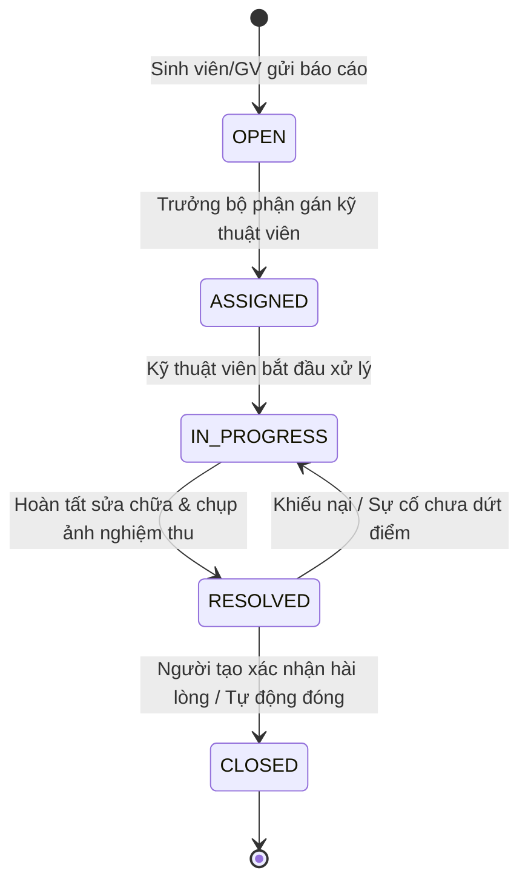

# UIT-FIXED
> Hệ Thống Quản Lý Vòng Đời Sự Cố (Ticketing System) Nội Bộ Dành Riêng Cho Trường Học

- **Khóa học:** AI-Driven Software Development with Scrum Training Course (University of Information Technology - UIT & Axon Active)
- **Nhóm thực hiện:** AURA FAMI

---

## 1. Giới thiệu Sản phẩm (Product Overview)

UIT-FIXED là giải pháp phần mềm web quản lý vòng đời sự cố (Ticketing System) nội bộ được thiết kế chuyên biệt cho môi trường giáo dục đại học và trường học. 

Hệ thống giúp số hóa toàn diện quy trình: từ tiếp nhận phản ánh sự cố cơ sở vật chất (máy chiếu, đèn, điều hòa, mạng internet, bàn ghế...), điều phối kỹ thuật viên, theo dõi tiến độ xử lý theo thời gian thực, cho đến phân tích báo cáo vi phạm SLA phục vụ công tác điều hành của Ban Giám hiệu.

---

## 2. Tính năng Nổi bật (Core Features)

### 1. Báo cáo Nhanh qua Form (Dành cho Sinh viên & Giảng viên)
- Giao diện thân thiện, tối ưu cho cả máy tính và thiết bị di động.
- Đính kèm hình ảnh hiện trường sự cố trực tiếp (sử dụng công nghệ Buffer Streaming đẩy thẳng lên Cloudinary CDN không tốn dung lượng máy chủ).
- Chọn nhanh vị trí theo cấu trúc phân tầng của trường học: Cơ sở -> Tòa nhà -> Tầng -> Phòng học/Khu vực chức năng.
- Gợi ý phân loại sự cố (Điện tử, Điện lạnh, Mạng, Bàn ghế, Vệ sinh) và mức độ khẩn cấp.

### 2. Workflow Tự Động Hóa (State Machine Chuẩn Hóa)
Quy trình xử lý sự cố khép kín, minh bạch và có trách nhiệm giải trình cao qua 5 trạng thái:
- **OPEN**: Sự cố vừa được báo cáo, chờ phân công.
- **ASSIGNED**: Đã phân công kỹ thuật viên/đội bảo trì chuyên trách.
- **IN_PROGRESS**: Kỹ thuật viên đang có mặt xử lý tại hiện trường.
- **RESOLVED**: Kỹ thuật viên hoàn tất sửa chữa, đính kèm ảnh nghiệm thu.
- **CLOSED**: Người báo cáo (hoặc Admin) xác nhận nghiệm thu thành công và đánh giá độ hài lòng.



### 3. Hệ thống Thông báo Thời Gian Thực (Real-time Notification)
- Tự động gửi Email & Thông báo trên Web ngay khi ticket thay đổi trạng thái hoặc có người phụ trách mới.
- Cảnh báo nhắc nhở kỹ thuật viên khi ticket sắp chạm ngưỡng cam kết thời gian xử lý (SLA deadline).

### 4. Dashboard Phân tích Dữ liệu & Báo cáo SLA (Dành cho BGH & Quản lý)
- **Bản đồ nhiệt & Thống kê theo khu vực**: Xác định tòa nhà, phòng học nào thường xuyên xảy ra sự cố nhất để có kế hoạch bảo trì phòng ngừa định kỳ.
- **Chỉ số SLA & MTTR**: Đo lường thời gian trung bình để phản hồi (MTTA) và thời gian giải quyết sự cố (MTTR).
- **Tỷ lệ vi phạm cam kết SLA**: Cung cấp báo cáo trực quan cho Ban Giám hiệu đánh giá năng suất của từng đội kỹ thuật.

---

## 3. Phân quyền Người dùng (RBAC)

| Vai trò | Quyền hạn chính |
| :--- | :--- |
| **Sinh viên / Giảng viên** *(Student / Teacher)* | Tạo ticket mới, đính kèm ảnh sự cố, theo dõi tiến độ xử lý ticket của mình, xác nhận đóng ticket và đánh giá dịch vụ. |
| **Kỹ thuật viên** *(Technician)* | Tiếp nhận ticket được gán, cập nhật tiến độ (In Progress -> Resolved), upload ảnh kết quả sửa chữa, ghi log vật tư thay thế. |
| **Điều phối viên** *(Dispatcher / Supervisor)* | Phân loại ticket, gán kỹ thuật viên phụ trách, theo dõi deadline SLA, mở lại ticket nếu chưa đạt chuẩn. |
| **Ban Giám hiệu / Quản trị viên** *(Admin)* | Xem toàn quyền Dashboard thống kê, cấu hình SLA, quản lý danh mục phòng ốc, xuất báo cáo định kỳ. |

---

## 4. Kiến trúc Hệ thống & Công nghệ (Tech Stack)

```text
UIT-FIXED (Monorepo)
├── docker-compose.yml          # Điều phối 3 container: postgres, backend, frontend
├── .env.example / .env         # Cấu hình biến môi trường toàn cục
│
├── backend/                    # NestJS API (NodeNext + Modular Clean Architecture)
│   ├── Dockerfile              # Multi-stage build
│   ├── prisma/schema.prisma    # PostgreSQL Schema (User, Ticket, Media, Comment, SLA)
│   └── src/
│       ├── common/             # Interceptors, Filters, Pipes, Guards
│       ├── config/             # Cloudinary, Database & App config
│       ├── core/database/      # PrismaService (Auto connect/disconnect)
│       ├── shared/cloudinary/  # Cloudinary Buffer Streamer
│       └── modules/media/      # API Upload media hình ảnh hiện trường
│
└── frontend/                   # ReactJS (Vite + TypeScript + Feature-Based)
    ├── Dockerfile & nginx.conf # Docker build & Nginx production serve
    └── src/
        ├── App.tsx             # Dashboard giao diện chính
        ├── features/media/     # Uploader ảnh hiện trường với live preview
        ├── lib/axios.ts        # Axios interceptor tự inject token
        └── utils/              # Helper tối ưu ảnh Cloudinary (f_auto, q_auto)
```

---

## 5. Hướng dẫn Khởi chạy Nhanh (Quick Start)

### 1. Chuẩn bị biến môi trường
Tạo file .env từ file mẫu và bổ sung thông tin Cloudinary:
```bash
cp .env.example .env
```
Cập nhật các khóa sau trong file .env:
```env
CLOUDINARY_CLOUD_NAME=your_cloudinary_cloud_name
CLOUDINARY_API_KEY=your_api_key
CLOUDINARY_API_SECRET=your_api_secret
```

### 2. Khởi động toàn bộ bằng Docker (Khuyên dùng)
```bash
docker compose up --build
```
Truy cập hệ thống:
- **Giao diện Web (Frontend):** http://localhost:3000
- **Giao diện API Docs / Endpoint:** http://localhost:5000/api/v1
- **Cơ sở dữ liệu PostgreSQL:** localhost:5432

### 3. Chạy từng phần ở môi trường Local Development

#### Chạy Backend:
```bash
cd backend
npm.cmd install
npx.cmd prisma generate
npm.cmd run start:dev
```

#### Chạy Frontend:
```bash
cd frontend
npm.cmd install
npm.cmd run dev
```
