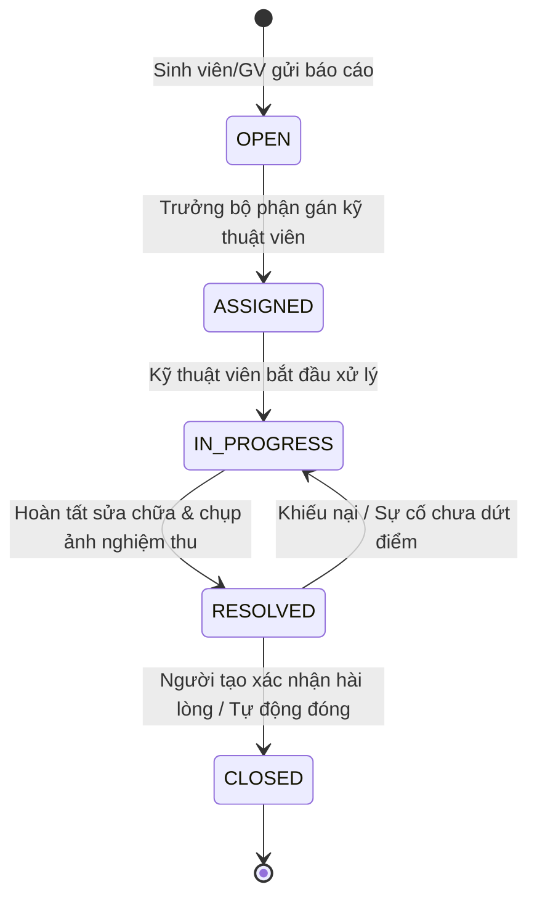

# UIT-FIXED
> Hệ Thống Quản Lý Vòng Đời Sự Cố (Ticketing System) Nội Bộ Dành Riêng Cho Trường Học

- **Khóa học:** AI-Driven Software Development with Scrum Training Course (University of Information Technology - UIT & Axon Active)
- **Nhóm thực hiện:** AURA FAMI

---

## 1. Giới thiệu Sản phẩm (Product Overview)

UIT-FIXED là giải pháp phần mềm web quản lý vòng đời sự cố (Ticketing System) nội bộ được thiết kế chuyên biệt cho môi trường giáo dục đại học và trường học. 

Hệ thống giúp số hóa toàn diện quy trình: từ tiếp nhận phản ánh sự cố cơ sở vật chất (máy chiếu, đèn, điều hòa, mạng internet, bàn ghế...), điều phối kỹ thuật viên, theo dõi tiến độ xử lý theo thời gian thực, cho đến phân tích báo cáo vi phạm SLA phục vụ công tác điều hành của Ban Giám hiệu.

---

## 2. Tính năng Nổi bật (Core Features)

### 1. Báo cáo Nhanh qua Form (Dành cho Sinh viên & Giảng viên)
- Giao diện thân thiện, tối ưu cho cả máy tính và thiết bị di động.
- Đính kèm hình ảnh hiện trường sự cố trực tiếp (sử dụng công nghệ Buffer Streaming đẩy thẳng lên Cloudinary CDN không tốn dung lượng máy chủ).
- Chọn nhanh vị trí theo cấu trúc phân tầng của trường học: Cơ sở -> Tòa nhà -> Tầng -> Phòng học/Khu vực chức năng.
- Gợi ý phân loại sự cố (Điện tử, Điện lạnh, Mạng, Bàn ghế, Vệ sinh) và mức độ khẩn cấp.

### 2. Workflow Tự Động Hóa (State Machine Chuẩn Hóa)
Quy trình xử lý sự cố khép kín, minh bạch và có trách nhiệm giải trình cao qua 5 trạng thái:
- **OPEN**: Sự cố vừa được báo cáo, chờ phân công.
- **ASSIGNED**: Đã phân công kỹ thuật viên/đội bảo trì chuyên trách.
- **IN_PROGRESS**: Kỹ thuật viên đang có mặt xử lý tại hiện trường.
- **RESOLVED**: Kỹ thuật viên hoàn tất sửa chữa, đính kèm ảnh nghiệm thu.
- **CLOSED**: Người báo cáo (hoặc Admin) xác nhận nghiệm thu thành công và đánh giá độ hài lòng.



### 3. Hệ thống Thông báo Thời Gian Thực (Real-time Notification)
- Tự động gửi Email & Thông báo trên Web ngay khi ticket thay đổi trạng thái hoặc có người phụ trách mới.
- Cảnh báo nhắc nhở kỹ thuật viên khi ticket sắp chạm ngưỡng cam kết thời gian xử lý (SLA deadline).

### 4. Dashboard Phân tích Dữ liệu & Báo cáo SLA (Dành cho BGH & Quản lý)
- **Bản đồ nhiệt & Thống kê theo khu vực**: Xác định tòa nhà, phòng học nào thường xuyên xảy ra sự cố nhất để có kế hoạch bảo trì phòng ngừa định kỳ.
- **Chỉ số SLA & MTTR**: Đo lường thời gian trung bình để phản hồi (MTTA) và thời gian giải quyết sự cố (MTTR).
- **Tỷ lệ vi phạm cam kết SLA**: Cung cấp báo cáo trực quan cho Ban Giám hiệu đánh giá năng suất của từng đội kỹ thuật.

---

## 3. Phân quyền Người dùng (RBAC)

| Vai trò | Quyền hạn chính |
| :--- | :--- |
| **Sinh viên / Giảng viên** *(Student / Teacher)* | Tạo ticket mới, đính kèm ảnh sự cố, theo dõi tiến độ xử lý ticket của mình, xác nhận đóng ticket và đánh giá dịch vụ. |
| **Kỹ thuật viên** *(Technician)* | Tiếp nhận ticket được gán, cập nhật tiến độ (In Progress -> Resolved), upload ảnh kết quả sửa chữa, ghi log vật tư thay thế. |
| **Điều phối viên** *(Dispatcher / Supervisor)* | Phân loại ticket, gán kỹ thuật viên phụ trách, theo dõi deadline SLA, mở lại ticket nếu chưa đạt chuẩn. |
| **Ban Giám hiệu / Quản trị viên** *(Admin)* | Xem toàn quyền Dashboard thống kê, cấu hình SLA, quản lý danh mục phòng ốc, xuất báo cáo định kỳ. |

---

## 4. Kiến trúc Hệ thống & Công nghệ (Tech Stack)

```text
UIT-FIXED (Monorepo)
├── docker-compose.yml          # Điều phối 3 container: postgres, backend, frontend
├── .env.example / .env         # Cấu hình biến môi trường toàn cục
│
├── doc/                        # Tài liệu dự án
│   ├── uc/                     # Use Cases
│   └── diagram/                # Diagrams
│
├── backend/                    # NestJS API (NodeNext + Modular Clean Architecture)
│   ├── Dockerfile              # Multi-stage build
│   ├── prisma/schema.prisma    # PostgreSQL Schema (User, Ticket, Media, Comment, SLA)
│   └── src/
│       ├── common/             # Interceptors, Filters, Pipes, Guards
│       ├── config/             # Cloudinary, Database & App config
│       ├── core/database/      # PrismaService (Auto connect/disconnect)
│       ├── shared/cloudinary/  # Cloudinary Buffer Streamer
│       └── modules/media/      # API Upload media hình ảnh hiện trường
│
└── frontend/                   # ReactJS (Vite + TypeScript + Feature-Based)
    ├── Dockerfile & nginx.conf # Docker build & Nginx production serve
    └── src/
        ├── App.tsx             # Dashboard giao diện chính
        ├── features/media/     # Uploader ảnh hiện trường với live preview
        ├── lib/axios.ts        # Axios interceptor tự inject token
        └── utils/              # Helper tối ưu ảnh Cloudinary (f_auto, q_auto)
```

---

## 5. Công cụ và Phiên bản Sử dụng (Tools & Environment Versions)

| Hạng mục | Công nghệ / Công cụ | Phiên bản | Ghi chú |
| :--- | :--- | :--- | :--- |
| **Runtime Môi trường** | **Node.js** | `>= 20.x` (LTS) / `v24.x` | Khuyến nghị Node.js 20 LTS trở lên (Container dùng node:20-alpine) |
| **Trình quản lý gói** | **npm** | `>= 10.x` / `11.x` | Sử dụng `npm.cmd` trên Windows PowerShell |
| **Hạ tầng Container** | **Docker & Docker Compose** | `Docker 28.x`, `Compose v2.x` | Đóng gói toàn bộ PostgreSQL, Backend, Frontend |
| **Cơ sở dữ liệu** | **PostgreSQL** | `16-alpine` | Chạy container hóa với volume lưu trữ độc lập |
| **Công cụ ORM** | **Prisma ORM** | `^6.4.1` | Quản trị schema, migration và type-safe query |
| **Backend Framework** | **NestJS** | `^12.0.1` | NodeNext ESM, Kiến trúc module phân tầng chuẩn Enterprise |
| **Upload & Lưu trữ Media** | **Cloudinary SDK & Multer** | `cloudinary ^2.x`, `streamifier` | Xử lý Buffer Streaming trực tiếp từ RAM |
| **Frontend Framework** | **ReactJS** | `^19.3.1` | Kiến trúc Feature-Sliced |
| **Frontend Build Tool** | **Vite** | `^8.3.5` | Bundler tốc độ cao, hỗ trợ HMR |
| **Ngôn ngữ phát triển** | **TypeScript** | `>= 6.0` (Backend), `~7.0` (Frontend) | Type-safe toàn diện từ DB sang Client |
| **State Management** | **TanStack Query & Zustand** | Query `^5.66.0`, Zustand `^5.0.3` | Cache server state và quản lý auth store |
| **HTTP Client** | **Axios** | `^1.7.9` | Interceptor tự động gắn JWT và xử lý lỗi |
| **Web Server Production** | **Nginx** | `alpine` | Phục vụ static web và reverse proxy cho React |
| **Hệ thống Quản lý Mã nguồn**| **Git & GitHub** | `main branch` | Điều phối mã nguồn theo quy chuẩn Scrum |

---

## 6. Hướng dẫn Cài đặt & Khởi chạy (Quick Start)

### 1. Yêu cầu Tiên quyết (Prerequisites)
- Đã cài đặt **Git**
- Đã cài đặt **Node.js >= 20.x LTS**
- Đã cài đặt **Docker & Docker Desktop** (khuyên dùng)

### 2. Tải mã nguồn & Cấu hình môi trường
```bash
# 1. Clone repository về máy
git clone https://github.com/phamhuy273/UIT-FIXED.git
cd UIT-FIXED

# 2. Tạo file cấu hình môi trường từ mẫu
cp .env.example .env
```
Mở file `.env` và điền thông tin tài khoản Cloudinary của bạn:
```env
CLOUDINARY_CLOUD_NAME=your_cloudinary_cloud_name
CLOUDINARY_API_KEY=your_api_key
CLOUDINARY_API_SECRET=your_api_secret
```

### 3. Cách 1: Khởi chạy nhanh bằng Docker (Khuyên dùng)
Chỉ với 1 câu lệnh để chạy toàn bộ PostgreSQL, Backend và Frontend trong môi trường cách ly:
```bash
docker compose up --build
```
Sau khi các container khởi động, đồng bộ schema vào PostgreSQL:
```bash
docker compose exec backend npx prisma db push
```
- **Giao diện Web (Frontend):** http://localhost:3000
- **Giao diện API Docs / Endpoint:** http://localhost:5000/api/v1
- **Cơ sở dữ liệu PostgreSQL:** localhost:5432

### 4. Cách 2: Chạy trên máy cục bộ (Local Development)

#### Bước 4.1: Khởi động cơ sở dữ liệu PostgreSQL (qua Docker)
```bash
docker compose up -d postgres
```

#### Bước 4.2: Cài đặt và khởi chạy Backend (NestJS)
```bash
cd backend
npm.cmd install

# Tạo Prisma Client và đồng bộ bảng vào PostgreSQL
npx.cmd prisma generate
npx.cmd prisma db push

# Chạy server ở chế độ Development (Watch mode)
npm.cmd run start:dev
```

#### Bước 4.3: Cài đặt và khởi chạy Frontend (ReactJS)
Mở một cửa sổ Terminal mới:
```bash
cd frontend
npm.cmd install

# Chạy server giao diện
npm.cmd run dev
```

*Lưu ý trên Windows PowerShell: Nếu gặp lỗi chặn chạy script (`ExecutionPolicy`), hãy sử dụng lệnh có đuôi `.cmd` (ví dụ `npm.cmd`, `npx.cmd`).*

---

## 7. Quy trình Làm việc với Git & GitHub (GitHub Workflow)

Để đảm bảo chất lượng mã nguồn và phối hợp hiệu quả giữa các thành viên nhóm AURA FAMI theo mô hình Scrum, dự án áp dụng quy trình Git Workflow chuẩn hóa như sau:

### 1. Chiến lược Phân nhánh (Branching Strategy)
- **`main`**: Nhánh ổn định, chứa mã nguồn sẵn sàng triển khai (Production/Release). Chỉ merge từ `develop` khi kết thúc Sprint Review.
- **`develop`**: Nhánh tích hợp mã nguồn chính trong suốt quá trình phát triển của Sprint.
- **`feature/<ten-tinh-nang>`**: Nhánh phát triển tính năng mới của từng thành viên (tách từ `develop`).
  - Ví dụ: `feature/report-incident-form`, `feature/auth-jwt`, `feature/media-upload`
- **`bugfix/<ten-loi>`**: Nhánh sửa lỗi phát hiện trong quá trình kiểm thử nội bộ Sprint.
- **`hotfix/<ten-loi>`**: Nhánh xử lý sự cố khẩn cấp trực tiếp trên `main`.

### 2. Quy ước Thông điệp Commit (Conventional Commits)
Cấu trúc chuẩn: `<type>(<scope>): <mo ta ngan gon>`
- **`feat`**: Phát triển tính năng mới (Ví dụ: `feat(media): implement buffer streaming upload to cloudinary`).
- **`fix`**: Sửa lỗi trong code (Ví dụ: `fix(auth): handle token expiration correctly`).
- **`docs`**: Cập nhật tài liệu, README (Ví dụ: `docs(readme): add github workflow`).
- **`refactor`**: Tái cấu trúc mã nguồn không làm thay đổi logic (Ví dụ: `refactor(prisma): optimize database queries`).
- **`chore`**: Cấu hình công cụ, dependencies, docker (Ví dụ: `chore(docker): update node alpine base image`).

### 3. Quy trình Đóng góp Mã nguồn qua Pull Request (PR)
1. **Cập nhật mã nguồn mới nhất:**
   ```bash
   git checkout develop
   git pull origin develop
   ```
2. **Tạo nhánh làm việc mới cho tính năng:**
   ```bash
   git checkout -b feature/ten-tinh-nang
   ```
3. **Commit mã nguồn theo quy ước:**
   ```bash
   git add .
   git commit -m "feat(scope): mo ta cong viec da lam"
   ```
4. **Đẩy nhánh lên GitHub:**
   ```bash
   git push origin feature/ten-tinh-nang
   ```
5. **Mở Pull Request trên GitHub:**
   - Chọn Base branch: `develop` <- Compare branch: `feature/ten-tinh-nang`.
   - Điền mô tả chi tiết nội dung thay đổi, gắn nhãn (Label) tương ứng với Sprint Backlog Item.
   - Yêu cầu ít nhất 1 thành viên trong nhóm (Peer Review) duyệt và approve trước khi tiến hành merge vào `develop`.
