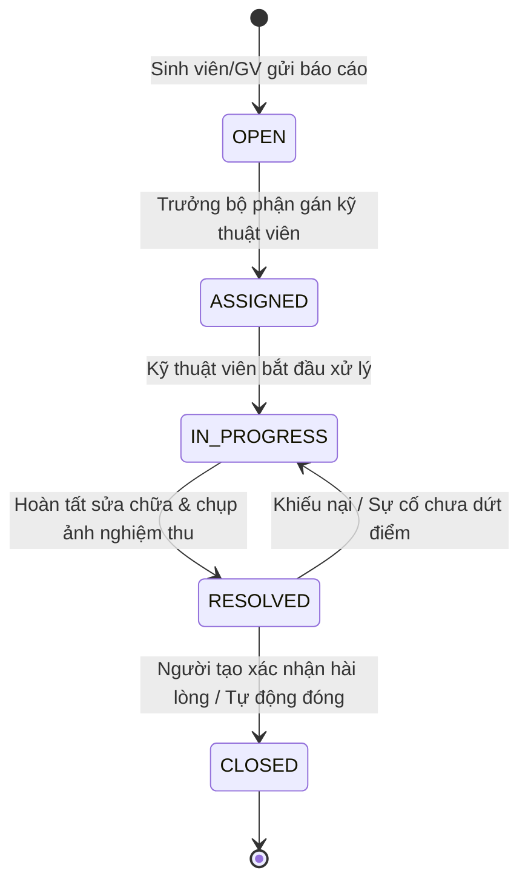

# UIT-FIXED
> Hệ Thống Quản Lý Vòng Đời Sự Cố (Ticketing System) Nội Bộ Dành Riêng Cho Trường Học

- **Khóa học:** AI-Driven Software Development with Scrum Training Course (University of Information Technology - UIT & Axon Active)
- **Nhóm thực hiện:** AURA FAMI

---

## 1. Giới thiệu Sản phẩm (Product Overview)

UIT-FIXED là giải pháp phần mềm web quản lý vòng đời sự cố (Ticketing System) nội bộ được thiết kế chuyên biệt cho môi trường giáo dục đại học và trường học. 

Hệ thống giúp số hóa toàn diện quy trình: từ tiếp nhận phản ánh sự cố cơ sở vật chất (máy chiếu, đèn, điều hòa, mạng internet, bàn ghế...), điều phối kỹ thuật viên, theo dõi tiến độ xử lý theo thời gian thực, cho đến phân tích báo cáo vi phạm SLA phục vụ công tác điều hành của Ban Giám hiệu.

---

## 2. Tính năng Nổi bật (Core Features)

### 1. Báo cáo Nhanh qua Form (Dành cho Sinh viên & Giảng viên)
- Giao diện thân thiện, tối ưu cho cả máy tính và thiết bị di động.
- Đính kèm hình ảnh hiện trường sự cố trực tiếp (sử dụng công nghệ Buffer Streaming đẩy thẳng lên Cloudinary CDN không tốn dung lượng máy chủ).
- Chọn nhanh vị trí theo cấu trúc phân tầng của trường học: Cơ sở -> Tòa nhà -> Tầng -> Phòng học/Khu vực chức năng.
- Gợi ý phân loại sự cố (Điện tử, Điện lạnh, Mạng, Bàn ghế, Vệ sinh) và mức độ khẩn cấp.

### 2. Workflow Tự Động Hóa (State Machine Chuẩn Hóa)
Quy trình xử lý sự cố khép kín, minh bạch và có trách nhiệm giải trình cao qua 5 trạng thái:
- **OPEN**: Sự cố vừa được báo cáo, chờ phân công.
- **ASSIGNED**: Đã phân công kỹ thuật viên/đội bảo trì chuyên trách.
- **IN_PROGRESS**: Kỹ thuật viên đang có mặt xử lý tại hiện trường.
- **RESOLVED**: Kỹ thuật viên hoàn tất sửa chữa, đính kèm ảnh nghiệm thu.
- **CLOSED**: Người báo cáo (hoặc Admin) xác nhận nghiệm thu thành công và đánh giá độ hài lòng.



### 3. Hệ thống Thông báo Thời Gian Thực (Real-time Notification)
- Tự động gửi Email & Thông báo trên Web ngay khi ticket thay đổi trạng thái hoặc có người phụ trách mới.
- Cảnh báo nhắc nhở kỹ thuật viên khi ticket sắp chạm ngưỡng cam kết thời gian xử lý (SLA deadline).

### 4. Dashboard Phân tích Dữ liệu & Báo cáo SLA (Dành cho BGH & Quản lý)
- **Bản đồ nhiệt & Thống kê theo khu vực**: Xác định tòa nhà, phòng học nào thường xuyên xảy ra sự cố nhất để có kế hoạch bảo trì phòng ngừa định kỳ.
- **Chỉ số SLA & MTTR**: Đo lường thời gian trung bình để phản hồi (MTTA) và thời gian giải quyết sự cố (MTTR).
- **Tỷ lệ vi phạm cam kết SLA**: Cung cấp báo cáo trực quan cho Ban Giám hiệu đánh giá năng suất của từng đội kỹ thuật.

---

## 3. Phân quyền Người dùng (RBAC)

| Vai trò | Quyền hạn chính |
| :--- | :--- |
| **Sinh viên / Giảng viên** *(Student / Teacher)* | Tạo ticket mới, đính kèm ảnh sự cố, theo dõi tiến độ xử lý ticket của mình, xác nhận đóng ticket và đánh giá dịch vụ. |
| **Kỹ thuật viên** *(Technician)* | Tiếp nhận ticket được gán, cập nhật tiến độ (In Progress -> Resolved), upload ảnh kết quả sửa chữa, ghi log vật tư thay thế. |
| **Điều phối viên** *(Dispatcher / Supervisor)* | Phân loại ticket, gán kỹ thuật viên phụ trách, theo dõi deadline SLA, mở lại ticket nếu chưa đạt chuẩn. |
| **Ban Giám hiệu / Quản trị viên** *(Admin)* | Xem toàn quyền Dashboard thống kê, cấu hình SLA, quản lý danh mục phòng ốc, xuất báo cáo định kỳ. |

---

## 4. Kiến trúc Hệ thống & Công nghệ (Tech Stack)

```text
UIT-FIXED (Monorepo)
├── docker-compose.yml          # Điều phối 3 container: postgres, backend, frontend
├── .env.example / .env         # Cấu hình biến môi trường toàn cục
│
├── doc/                        # Tài liệu dự án
│   ├── uc/                     # Use Cases
│   └── diagram/                # Diagrams
│
├── backend/                    # NestJS API (NodeNext + Modular Clean Architecture)
│   ├── Dockerfile              # Multi-stage build
│   ├── prisma/schema.prisma    # PostgreSQL Schema (User, Ticket, Media, Comment, SLA)
│   └── src/
│       ├── common/             # Interceptors, Filters, Pipes, Guards
│       ├── config/             # Cloudinary, Database & App config
│       ├── core/database/      # PrismaService (Auto connect/disconnect)
│       ├── shared/cloudinary/  # Cloudinary Buffer Streamer
│       └── modules/media/      # API Upload media hình ảnh hiện trường
│
└── frontend/                   # ReactJS (Vite + TypeScript + Feature-Based)
    ├── Dockerfile & nginx.conf # Docker build & Nginx production serve
    └── src/
        ├── App.tsx             # Dashboard giao diện chính
        ├── features/media/     # Uploader ảnh hiện trường với live preview
        ├── lib/axios.ts        # Axios interceptor tự inject token
        └── utils/              # Helper tối ưu ảnh Cloudinary (f_auto, q_auto)
```

---

## 5. Công cụ và Phiên bản Sử dụng (Tools & Environment Versions)

| Hạng mục | Công nghệ / Công cụ | Phiên bản | Ghi chú |
| :--- | :--- | :--- | :--- |
| **Runtime Môi trường** | **Node.js** | `24.x` cho hướng dẫn local bên dưới | Bản local + AI được kiểm tra trên Node.js 24; Dockerfile hiện dùng node:20-alpine, chưa xác minh full-stack AI |
| **Trình quản lý gói** | **npm** | `>= 10.x` / `11.x` | Sử dụng `npm.cmd` trên Windows PowerShell |
| **Hạ tầng Container** | **Docker & Docker Compose** | `Docker 28.x`, `Compose v2.x` | Đóng gói toàn bộ PostgreSQL, Backend, Frontend |
| **Cơ sở dữ liệu** | **PostgreSQL** | `16-alpine` | Chạy container hóa với volume lưu trữ độc lập |
| **Công cụ ORM** | **Prisma ORM** | `^6.4.1` | Quản trị schema, migration và type-safe query |
| **Backend Framework** | **NestJS** | `^12.0.1` | NodeNext ESM, Kiến trúc module phân tầng chuẩn Enterprise |
| **Upload & Lưu trữ Media** | **Cloudinary SDK & Multer** | `cloudinary ^2.x`, `streamifier` | Xử lý Buffer Streaming trực tiếp từ RAM |
| **Frontend Framework** | **ReactJS** | `^19.3.1` | Kiến trúc Feature-Sliced |
| **Frontend Build Tool** | **Vite** | `^8.3.5` | Bundler tốc độ cao, hỗ trợ HMR |
| **Ngôn ngữ phát triển** | **TypeScript** | `>= 6.0` (Backend), `~7.0` (Frontend) | Type-safe toàn diện từ DB sang Client |
| **State Management** | **TanStack Query & Zustand** | Query `^5.66.0`, Zustand `^5.0.3` | Cache server state và quản lý auth store |
| **HTTP Client** | **Axios** | `^1.7.9` | Interceptor tự động gắn JWT và xử lý lỗi |
| **Web Server Production** | **Nginx** | `alpine` | Phục vụ static web và reverse proxy cho React |
| **Hệ thống Quản lý Mã nguồn**| **Git & GitHub** | `main branch` | Điều phối mã nguồn theo quy chuẩn Scrum |

---

## 6. Hướng dẫn Cài đặt & Khởi chạy, bao gồm AI Duplicate

Hướng dẫn đã kiểm tra: **PostgreSQL chạy Docker; backend, frontend và AI chạy local**.
Các lệnh dưới đây dùng Windows PowerShell. Trên Linux/macOS, dùng `npm` thay `npm.cmd`.

### 6.1. Chuẩn bị và lấy đúng source

- Git, Node.js **24.x**, npm và Docker Desktop đang hoạt động.
- Có Internet để cài thư viện và tải model lần đầu; không bắt buộc GPU.
- Không cần cài Ollama, LM Studio hoặc một ứng dụng AI riêng.

```powershell
git clone https://github.com/phamhuy273/UIT-FIXED.git
cd UIT-FIXED
git fetch origin

# Khi tính năng AI chưa được merge vào main, dùng branch có đủ code AI:
git switch --track origin/feat/US-00-admin-duplicate-triage
```

Nếu đã có branch local, dùng `git switch feat/US-00-admin-duplicate-triage` rồi
`git pull --ff-only`. Khi AI đã được merge, có thể dùng branch tích hợp của nhóm.
GitHub chỉ cung cấp source; không tự cài thư viện, chạy migration hay tải model trên máy khác.

### 6.2. Cấu hình môi trường và PostgreSQL

Tại thư mục gốc repository:

```powershell
# Chỉ tạo file nếu chưa có, không ghi đè cấu hình đang dùng
if (!(Test-Path .env)) { Copy-Item .env.example .env }
```

Điền cấu hình PostgreSQL trong `.env` gốc, sau đó chạy:

```powershell
docker compose up -d postgres
docker compose ps postgres
if (!(Test-Path backend/.env)) { Copy-Item .env.example backend/.env }
```

Chỉnh **`backend/.env`** cho môi trường local:

- `DATABASE_URL`: dùng host **`127.0.0.1`**, port PostgreSQL đã cấu hình; user,
  password và tên DB phải khớp container. Host `postgres` chỉ dùng giữa các container.
- Cấu hình `JWT_SECRET`, `JWT_EXPIRES_IN` và thông tin Cloudinary của môi trường bạn dùng.
- Backend mặc định chạy port `5000`; nếu đổi thì dùng biến `PORT` và đồng bộ cấu hình frontend/CORS.

Không commit `.env`, không dùng chung thông tin xác thực cục bộ qua Git.
Nếu DB đã có dữ liệu, giữ nguyên volume và cấu hình kết nối; không reset DB hoặc xóa volume để cập nhật source.

### 6.3. Cài backend, áp dụng migration và chuẩn bị dữ liệu

```powershell
cd backend
npm.cmd ci
npm.cmd run db:generate
npm.cmd run db:validate
npm.cmd run db:migrate
npm.cmd run db:status

# Chạy khi cần nạp danh mục phòng học/danh mục sự cố vào DB phát triển
npm.cmd run db:seed
```

`db:migrate` dùng `prisma migrate deploy`, áp dụng cả migration AI đã có trong source.
Không dùng `prisma db push` để thay thế migration: các ràng buộc SQL và lịch sử migration
cũng là một phần của hệ thống. Seed danh mục không tạo tài khoản Admin hoặc tự sinh báo cáo mẫu.

### 6.4. Tải và khởi tạo model AI cục bộ

Vẫn ở thư mục `backend`, thực hiện trước khi chạy server:

```powershell
# Build, tải model vào cache nếu chưa có và kiểm tra vài câu tiếng Việt
npm.cmd run ai:warmup

# Build, tạo/cập nhật embedding cho report đang chờ duyệt hoặc đã duyệt trong DB hiện tại
npm.cmd run ai:index

# Chạy backend với chế độ theo dõi thay đổi
npm.cmd run start:dev
```

AI dùng **`Xenova/paraphrase-multilingual-MiniLM-L12-v2`**, ONNX q8, vector 384 chiều,
chạy trên **CPU của máy chạy backend** qua `@huggingface/transformers`.
Model được cố định phiên bản trong code và tải vào `backend/.cache/models`.
Vector report nằm trong bảng `report_embeddings` của DB đang kết nối.

Nội dung report được xử lý cục bộ, không gửi tới API suy luận AI bên ngoài.
Máy mới phải tự tải model và tạo embedding từ DB của máy đó; cache model/DB không đi cùng Git.
Chạy lại `ai:index` an toàn để bổ sung/refresh dữ liệu dẫn xuất; report thiếu embedding
cũng được xử lý khi có lượt kiểm tra phù hợp.

Các biến tùy chọn cho backend trong `backend/.env`:

```env
AI_DUPLICATES_ENABLED=true
AI_DUPLICATE_THRESHOLD=0.80
# Chỉ bật true sau khi đã tải đủ model vào cache
AI_MODEL_OFFLINE=false
```

Ngưỡng `0.80` là cosine similarity thử nghiệm, **không phải xác suất trùng 80%**.
Độ chính xác cần được đánh giá bằng dữ liệu tiếng Việt thực tế.
AI lỗi hoặc phản hồi chậm thì sinh viên vẫn gửi được, Admin vẫn xem danh sách thường.

### 6.5. Cài và chạy frontend

Mở terminal mới tại thư mục gốc repository:

```powershell
cd frontend
npm.cmd ci
npm.cmd run dev -- --host 127.0.0.1 --port 3000 --strictPort
```

Frontend mặc định gọi `http://localhost:5000/api/v1`. Nếu cần cấu hình khác,
tạo `frontend/.env.local` với `VITE_API_BASE_URL` phù hợp rồi chạy lại Vite.

- **Web:** [http://localhost:3000](http://localhost:3000)
- **API base:** [http://localhost:5000/api/v1](http://localhost:5000/api/v1)
- **Tạo report:** `/reports/new`, dùng tài khoản STUDENT.
- **Nhóm report Admin:** `/admin/queue`, dùng tài khoản ADMIN đã được cấp.

Hướng dẫn này không xác nhận AI chạy trong full-stack Dockerfile Alpine hiện có.
Nếu triển khai AI bằng container, cần kiểm tra ONNX Runtime trên image đích và giữ
cache model bằng volume; không mặc định `docker compose up --build` đã chuẩn bị đủ AI.

### 6.6. Test nhanh AI Duplicate

1. Sinh viên A gửi report, ví dụ “Máy chiếu không lên nguồn” ở một phòng học.
2. Sinh viên B chọn **cùng phòng và cùng danh mục**, nhập một cách diễn đạt tương tự;
   ngừng nhập khoảng một giây để kiểm tra. Khác danh mục bị loại trước khi gọi AI.
3. Chọn **“Tôi cũng gặp sự cố này”**: theo dõi sự cố chung, không tạo thêm report chờ duyệt.
4. Muốn thử nhóm Admin: chọn tiếp tục gửi report mới thay vì cùng gặp lỗi, rồi đăng nhập
   Admin vào `/admin/queue` → **“Gom báo cáo tương tự”** → mở nhóm để đối chiếu từng report.
   **“Từ chối do trùng”** chỉ điền sẵn lý do; Admin vẫn cần xác nhận từng report.
5. Chỉ nhập **ngày + Sáng/Chiều/Không rõ**, không cần giờ phút. Nếu buổi phát hiện
   trùng buổi sửa, hệ thống hỏi lỗi xảy ra trước hay sau khi sửa; không tự đoán thứ tự.
6. Đổi phòng hoặc danh mục và thử một triệu chứng khác để kiểm tra kết quả không liên quan.

AI chỉ đề xuất, không tự gộp/xóa report. Admin grouping chỉ gom để xem và duyệt/từ chối
từng report riêng. Khi có quá nhiều report, nhóm AI hiển thị phạm vi đã xét và vẫn có
**“Danh sách thường”** để xem toàn bộ.

Chi tiết thuật toán, API, giới hạn và quyền riêng tư:
[AI_DUPLICATE_DETECTION.md](doc/AI_DUPLICATE_DETECTION.md).

### 6.7. Kiểm tra và xử lý lỗi khởi chạy

```powershell
# Trong backend — test tuần tự để ổn định trên Windows
npm.cmd run build
npm.cmd test -- --maxWorkers=1 --no-file-parallelism
npm.cmd run test:e2e -- --maxWorkers=1 --no-file-parallelism

# Trong frontend
npm.cmd run build
npm.cmd run lint
npm.cmd run test:master-data
npm.cmd run test:duplicates
```

| Triệu chứng | Cách xử lý |
| --- | --- |
| `npm ci` báo `EPERM` ở Prisma/ONNX/Vite DLL | Dừng đúng tiến trình backend/frontend của dự án đang giữ file, rồi cài lại. |
| Không kết nối được DB | Kiểm tra container healthy, port và `backend/.env`; backend local dùng host `127.0.0.1`. |
| Thiếu bảng `report_embeddings`/`report_confirmations` | Chạy `npm.cmd run db:migrate` và `db:generate` trong backend. |
| Model tải lỗi hoặc cache chưa đủ | Kiểm tra mạng, dung lượng và quyền ghi cache; chạy lại `ai:warmup`. Không bật offline trước lần tải thành công. |
| Chưa thấy gợi ý trùng | Kiểm tra đúng phòng/danh mục, mô tả đủ nội dung, AI đang bật và đã warmup/index. Gợi ý không bảo đảm phát hiện mọi cặp trùng. |
| Lỗi 401/403 | Đăng nhập lại và dùng đúng vai trò; trang nhóm report chỉ dành cho Admin. |
| Port 3000/5000 đã được sử dụng | Dừng đúng server cũ trước khi chạy server mới; không để frontend tự đổi port rồi gặp lỗi CORS. |

---

## 7. Quy trình Làm việc với Git & GitHub (GitHub Workflow)

Để đảm bảo chất lượng mã nguồn và phối hợp hiệu quả giữa các thành viên nhóm AURA FAMI theo mô hình Scrum, dự án áp dụng quy trình Git Workflow chuẩn hóa như sau:

### 1. Chiến lược Phân nhánh (Branching Strategy)
- **`main`**: Nhánh ổn định, chứa mã nguồn sẵn sàng triển khai (Production/Release). Chỉ merge từ `develop` khi kết thúc Sprint Review.
- **`develop`**: Nhánh tích hợp mã nguồn chính trong suốt quá trình phát triển của Sprint.
- **`feature/<ten-tinh-nang>`**: Nhánh phát triển tính năng mới của từng thành viên (tách từ `develop`).
  - Ví dụ: `feature/report-incident-form`, `feature/auth-jwt`, `feature/media-upload`
- **`bugfix/<ten-loi>`**: Nhánh sửa lỗi phát hiện trong quá trình kiểm thử nội bộ Sprint.
- **`hotfix/<ten-loi>`**: Nhánh xử lý sự cố khẩn cấp trực tiếp trên `main`.

### 2. Quy ước Thông điệp Commit (Conventional Commits)
Cấu trúc chuẩn: `<type>(<scope>): <mo ta ngan gon>`
- **`feat`**: Phát triển tính năng mới (Ví dụ: `feat(media): implement buffer streaming upload to cloudinary`).
- **`fix`**: Sửa lỗi trong code (Ví dụ: `fix(auth): handle token expiration correctly`).
- **`docs`**: Cập nhật tài liệu, README (Ví dụ: `docs(readme): add github workflow`).
- **`refactor`**: Tái cấu trúc mã nguồn không làm thay đổi logic (Ví dụ: `refactor(prisma): optimize database queries`).
- **`chore`**: Cấu hình công cụ, dependencies, docker (Ví dụ: `chore(docker): update node alpine base image`).

### 3. Quy trình Đóng góp Mã nguồn qua Pull Request (PR)
1. **Cập nhật mã nguồn mới nhất:**
   ```bash
   git checkout develop
   git pull origin develop
   ```
2. **Tạo nhánh làm việc mới cho tính năng:**
   ```bash
   git checkout -b feature/ten-tinh-nang
   ```
3. **Commit mã nguồn theo quy ước:**
   ```bash
   git add .
   git commit -m "feat(scope): mo ta cong viec da lam"
   ```
4. **Đẩy nhánh lên GitHub:**
   ```bash
   git push origin feature/ten-tinh-nang
   ```
5. **Mở Pull Request trên GitHub:**
   - Chọn Base branch: `develop` <- Compare branch: `feature/ten-tinh-nang`.
   - Điền mô tả chi tiết nội dung thay đổi, gắn nhãn (Label) tương ứng với Sprint Backlog Item.
   - Yêu cầu ít nhất 1 thành viên trong nhóm (Peer Review) duyệt và approve trước khi tiến hành merge vào `develop`.
